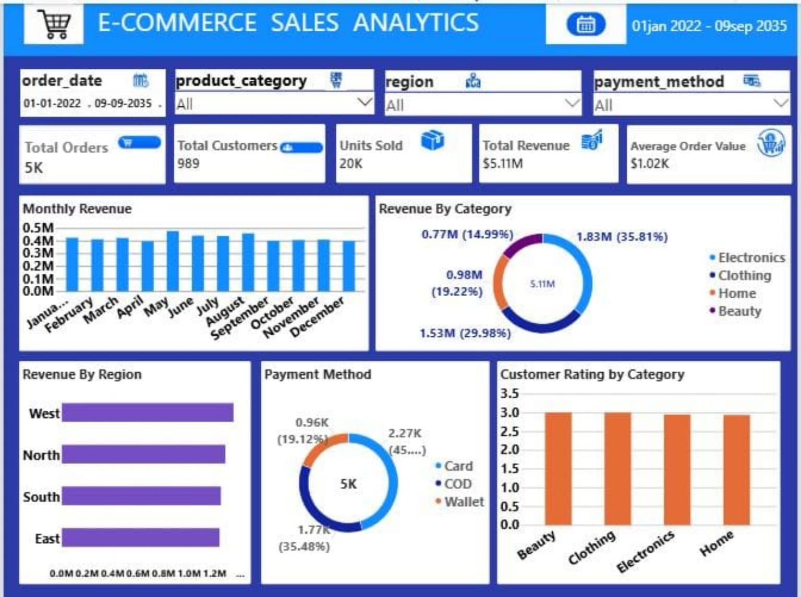

# E-Commerce Sales Analytics

An end-to-end data analytics project using Python, MySQL, and Power BI to analyze e-commerce sales performance and generate meaningful business insights.

## Project Overview

This project focuses on cleaning, analyzing, and visualizing e-commerce sales data to understand business performance, customer purchasing behavior, product category sales, regional performance, payment methods, customer satisfaction, delivery performance, and discount patterns.

The project uses Python and Pandas for data cleaning, MySQL for SQL analysis, and Power BI to build an interactive dashboard.

## Project Objectives

- Clean and prepare the dataset using Python and Pandas.
- Analyze sales data using SQL queries in MySQL.
- Identify top-performing product categories and regions.
- Analyze customer purchasing behavior and payment methods.
- Understand customer ratings and delivery performance.
- Explore the relationship between discount levels and revenue.
- Create an interactive Power BI dashboard for business reporting.

## Tools and Technologies

- Python
- Pandas
- Jupyter Notebook
- MySQL
- Power BI
- GitHub

## Project Structure

ecommerce-sales-analytics/
│
├── data/
│   └── ecommerce_sales_cleaned.csv
│
├── python/
│   └── data_cleaning.ipynb
│
├── sql/
│   ├── ecommerce_sales_analysis.sql
│   ├── sql_analysis_1.png
│   ├── sql_analysis_2.png
│   └── sql_analysis_3.png
│
├── powerbi/
│   └── ecommerce_sales_dashboard.pbix
│
├── screenshots/
│   └── dashboard.png
│
└── README.md

## Dataset Description

**Dataset:** `ecommerce_sales_cleaned.csv`

The cleaned dataset contains 5,000 rows and 12 columns.

| Column | Description |
|---|---|
| order_id | Unique order identifier |
| order_date | Date the order was placed |
| customer_id | Customer identifier |
| product_category | Product category |
| region | Sales region |
| quantity | Number of units purchased |
| unit_price | Price per unit |
| discount | Discount rate |
| payment_method | Payment method used |
| delivery_days | Number of days taken for delivery |
| customer_rating | Customer rating |
| revenue | Revenue recorded for the order after discount |

**Data Period:** January 1, 2022 – September 9, 2035

## Data Cleaning Using Python

The dataset was prepared using Python and Pandas in Jupyter Notebook.

The data preparation process includes:
- Inspecting the dataset structure and data types.
- Checking for missing values.
- Checking duplicate records.
- Validating column values and date formats.
- Preparing the cleaned dataset for SQL analysis and Power BI visualization.

**Notebook:** `python/data_cleaning.ipynb`

## SQL Analysis Using MySQL

SQL was used to analyze the cleaned dataset and answer important business questions.

The SQL analysis includes:
1. Dataset preview.
2. Overall business performance.
3. Monthly revenue trends.
4. Sales by product category.
5. Sales by region.
6. Top customers by total spending.
7. Payment method analysis.
8. Customer ratings by product category.
9. Delivery performance analysis.
10. Discount analysis.

**SQL File:** `sql/ecommerce_sales_analysis.sql`

### SQL Analysis Screenshots

The SQL query results are saved in the following files:

- `sql/sql_analysis_1.png`
- `sql/sql_analysis_2.png`
- `sql/sql_analysis_3.png`

## Power BI Dashboard

The interactive dashboard was developed using Power BI, with the cleaned CSV dataset as its data source.

### Dashboard Preview

*Power BI File:* [ecommerce_sales_dashboard.pbix](powerbi/ecommerce_sales_dashboard.pbix) | [Dashboard Screenshot](powerbi/dashboard.png)

### Dashboard Highlights

- Total Orders
- Total Customers
- Units Sold
- Total Revenue
- Average Order Value
- Monthly Revenue Trend
- Sales by Product Category
- Sales by Region
- Payment Method Analysis
- Customer Rating by Category
- Interactive filters for exploring sales data

## Business Questions and Key Findings

### 1. What is the overall sales performance?

- Total Orders: 5,000
- Unique Customers: 989
- Units Sold: 20,224
- Total Revenue: 5,109,775.74
- Average Revenue per Order: 1,021.96

**Finding:** The dataset records 5,000 orders from 989 unique customers, providing an overview of sales volume and revenue.

### 2. Which product category generates the most revenue?

| Product Category | Orders | Units Sold | Revenue |
|---|---:|---:|---:|
| Electronics | 1,777 | 7,109 | 1,829,899.22 |
| Clothing | 1,531 | 6,171 | 1,531,931.72 |
| Home | 969 | 3,949 | 982,083.92 |
| Beauty | 723 | 2,995 | 765,860.88 |

**Finding:** Electronics generates the highest revenue, followed by Clothing. Beauty records the lowest revenue among the four categories.

### 3. Which region contributes the most revenue?

| Region | Orders | Revenue |
|---|---:|---:|
| West | 1,289 | 1,345,582.16 |
| North | 1,276 | 1,281,508.45 |
| South | 1,208 | 1,246,640.90 |
| East | 1,227 | 1,236,044.23 |

**Finding:** The West region generates the highest revenue, while the East region records the lowest. Revenue is relatively close across all four regions.

### 4. Which payment method generates the most revenue?

| Payment Method | Orders | Revenue |
|---|---:|---:|
| Card | 2,270 | 2,366,248.20 |
| COD | 1,774 | 1,788,408.44 |
| Wallet | 956 | 955,119.10 |

**Finding:** Card is the most frequently used payment method and generates the highest revenue in this dataset.

### 5. Which customers have the highest total spending?

The SQL analysis groups orders by customer and ranks customers according to their total spending.

**Finding:** This analysis helps identify high-spending customers for further customer-retention analysis. Refer to the SQL query results for the actual top 10 customer IDs and spending totals.

### 6. How do customer ratings vary by product category?

| Product Category | Average Rating |
|---|---:|
| Beauty | 3.01 |
| Clothing | 3.01 |
| Electronics | 2.95 |
| Home | 2.94 |

**Finding:** Beauty and Clothing have the highest average ratings, while Home has the lowest. The differences between categories are small.

### 7. How does delivery time relate to customer ratings?

| Delivery Group | Orders | Average Rating |
|---|---:|---:|
| Fast (0–3 days) | 1,274 | 2.95 |
| Standard (4–7 days) | 1,843 | 3.03 |
| Slow (8+ days) | 1,883 | 2.94 |

**Finding:** The Standard delivery group has the highest average rating, while the Slow delivery group has the lowest. This comparison shows an association, not proof that delivery time alone causes differences in ratings.

### 8. How do discount levels compare by average revenue per order?

| Discount Group | Orders | Average Revenue per Order | Average Rating |
|---|---:|---:|---:|
| Low Discount (<10%) | 1,260 | 1,175.15 | 2.96 |
| Medium Discount (10–<25%) | 2,134 | 1,032.42 | 2.98 |
| High Discount (25%+) | 1,606 | 887.86 | 2.98 |

**Finding:** The low-discount group has the highest average revenue per order, while the high-discount group has the lowest. This comparison does not prove that discounts caused the difference.

### 9. How does revenue change over time?

The SQL analysis groups orders by month and calculates monthly order counts and revenue.

**Finding:** Monthly results can be used to identify revenue peaks, dips, and changes over time. Review the full SQL results and Power BI trend before drawing conclusions about growth or seasonality.

## How to Run the Project

### Step 1: Review the Dataset

Open `data/ecommerce_sales_cleaned.csv` using Excel, Python, or another CSV viewer.

### Step 2: Review the Python Notebook

Open `python/data_cleaning.ipynb` in Jupyter Notebook to review the data-cleaning process.

### Step 3: Run SQL Analysis

1. Open MySQL Workbench.
2. Connect to your MySQL server.
3. Open `sql/ecommerce_sales_analysis.sql`.
4. Execute the database and table creation statements.
5. Import `data/ecommerce_sales_cleaned.csv` into the `ecommerce_sales_cleaned` table in the `ecommerce_analytics` database.
6. Confirm that the table contains records.
7. Execute the SQL analysis queries.

**Important:** The SQL script creates the database and table but does not automatically import the CSV file. Import the dataset before running the analysis queries.

### Step 4: Open the Power BI Dashboard

Open `powerbi/ecommerce_sales_dashboard.pbix`.

The dashboard uses `data/ecommerce_sales_cleaned.csv` as its data source. If Power BI requests the file location on another computer, update the source path to the cleaned CSV file.

## Conclusion

This project demonstrates a practical data analytics workflow using Python for data preparation, MySQL for business analysis, and Power BI for interactive dashboard reporting.

It showcases foundational skills in data cleaning, SQL querying, data visualization, and business interpretation, making it suitable for a Data Analyst portfolio.

---

**Project Type:** Data Analyst Portfolio Project
